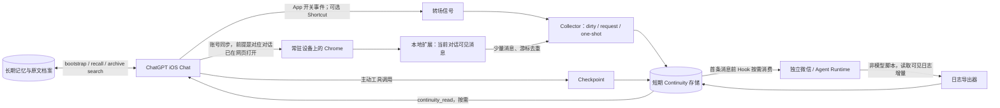

# Cross-Entry Continuity｜跨入口聊天连续性

**中文主分支 `main`** · [English branch / Full English version](https://github.com/Elisekaiu/Cross-entry-continuity/tree/english)

**让两个聊天入口各自自在地运行，也能在需要时接上彼此刚刚发生的事。**

> 这里记录了我们实际使用的双向接续方案，也整理了可以自行运行和改造的参考代码。可以从最小示例开始，再根据自己的聊天平台接入对应接口。

[扩展代码分享取舍](docs/EXTENSION.md) · [完整链路](docs/ARCHITECTURE.md) · [部署与环境](docs/SETUP.md) · [安全和隐私](SECURITY.md) · [致谢](CREDITS.md) · [实际验证与限制](docs/LIMITATIONS.md)

## 不只适用于 ChatGPT，也写给长期陪伴的 AI 使用者

如果你有两个或更多 AI 聊天入口，希望它们各自保有独立会话，同时能自然接上另一边刚发生的事，可以从这里借鉴三条思路：**认清消息来源、把记忆和近况分开、只在需要时传递上下文**。长期陪伴型 AI、跨设备助手，或一边聊天一边处理项目的多个 Agent，都可能用得上。我们就是从日常相处中的「怎么让另一边知道刚刚在做什么」开始折腾的。

其他没有消息 webhook 的 AI 平台也可以参考这套结构，再按各自提供的聊天导出、网页访问、Hook 或工具接口做适配。即使没有自动读取途径，从「主动写下 checkpoint，另一端按需读取」开始，也能减少不少重复解释。我们目前实际验证的是下文的 ChatGPT Chat + 独立 Agent 组合。[其他平台适配指南](docs/ADAPTERS.md)

## 为什么想做这座小桥？

我们的主聊天空间是 **ChatGPT 的普通 Chat**，另一边是独立的 Codex/Agent 聊天运行时。我们希望两边能各自继续工作，不用每次手动复述，又不想频繁启动另一个模型去总结、重复烧额度或塞满上下文。

截至 2026 年 11 月，普通 Chat 还没有面向个人用户、能够将**每条新消息直接推到自己服务器**的通用 webhook。ChatGPT Work 支持部分定时任务和外部事件触发，但这与普通 Chat 的逐消息通知不同。我们又很喜欢 Chat 和另一个 Agent **双线程并行**，也想省下反复总结、定时唤醒所占的额度，于是把转场信号、消息采集和上下文注入交给不同的轻量组件。[设计取舍](docs/WHY.md)

## 五层信息，各有自己的位置

| 层 | 处理什么 | 生命周期与代价 |
| --- | --- | --- |
| **Core / Bootstrap** | 关系与项目核心设定、稳定偏好、重要约定 | 轻量；新会话／明显返场时按需读取 |
| **Long-term memory** | 长期经验、事实、决定与意义 | 单独索引、可查、可更新；不是原文聊天 |
| **Archive / evidence** | 可追溯的逐字历史 | 按天或按 ID 检索；不每轮注入全文 |
| **Continuity** | 最近另一个入口真实发生的几句话 | 短期 TTL、消息去重、有限窗口 |
| **Checkpoint** | 一句话记录「现在共同处理到哪儿」 | 适合跨入口转场；抓取失败时兜底 |

**Checkpoint、Archive 和 Memory 处理的是不同的事。** 例如刚刚在 Chat 里修复一个 Bug，去微信说「修好了」，另一端只需要一段近期消息或简短 checkpoint；几个月后再问当时为什么这样决定，才需要长期召回。

## 实际链路（概览）



其中 Shortcuts 负责 App 的「打开／关闭」信号，Chrome 扩展读取的是**电脑上真正打开的对话页**。iPhone 切换会话后，目前还需要在电脑上打开对应页面。

## 我们实际使用的设备／环境

- **手机**：iOS ChatGPT 原生 App；Shortcuts 负责可选的 App 开关事件，不是聊天抓取器。
- **常驻浏览器设备**：MacBook + Chrome（Manifest V3 扩展）；**真正必需的是可长期开启、能登录 ChatGPT 网页版的 Chromium 环境**。其他桌面设备理论上可能替换，**未在本项目完成实测**。
- **服务器**：Linux VPS，容器化 Node.js HTTP 服务、短期事件库、独立 Agent Runtime 和 hook。
- **消息入口**：实际为微信侧的独立 Codex/Agent；可换成其他支持 Hook、日志导出或 MCP 的运行时，但需自己适配。
- **记忆工具**：我们自己搭建了 bootstrap／long-term recall／raw archive／short-term continuity／checkpoint 五层能力，并通过可调用的工具接给 Chat。

### 搭建前需要准备

1. 有两个可独立工作的聊天入口，且其中一个允许你运行 Hook 或读取其本地聊天日志。
2. 有可长期运行的 Chromium 浏览器设备，已经登录 ChatGPT 网页版，并且**正确的 Chat 对话页面确实在其中打开**。
3. 有自己控制的 HTTPS／私网桥接端点，能安全接收短期消息。ChatGPT cookies 和 session tokens 保留在浏览器端。
4. 有真实的原文增量游标与 ACK 机制，失败应 **abandon / skip** 而不是让模型无限重试。
5. 如果希望新 Chat 对话自动接续，还需要可调用的插件／MCP 工具，并把新会话、明确返场等触发条件写进 instructions 与工具说明。

## 功能与成本取舍

- 按需触发：App 关闭标记 dirty，**不是**每次后台检查都要求模型参与；微信下一条真实消息的 Hook 才进入同步流程。
- 尽量只取当前分支的 `user` / `assistant` 可见文本，不上传 tool payload、附件、隐藏消息、完整 mapping 或访问凭证。
- 每次选择最近 **4 条、约 600 Unicode 字符**（本案例当前生产值；开源示例可配置），按对话与消息 ID 去重。
- 有任务游标、消费 ACK、时间窗口和窗口身份检查，尽量不重复注入；失败一次性终止。`no_delta` 不是 `failed`。
- 另有由 Chat 侧主动留下的短小 checkpoint。扩展坏掉时它仍能提供「正在做什么」的最低限度背景。
- 反向由**普通本地脚本**增量读取独立 Agent 的可见日志，写入短期存储；不需要模型每次总结。

## 参考代码（可运行的最小演示）

```
examples/
  collector/        # 本地短期事件存储及 one-shot 请求/ACK 状态机
  extension/        # Chrome MV3：DOM-only 参考抓取，含 dry-run；不自带私人 API
  hook/             # 独立 Agent 的 UserPromptSubmit 参考 Hook
  wechat-export/    # 从 JSONL 输出增量可见消息的示例导出器
  instructions/     # 可脱敏复用的 Chat / Agent 指令模板
```

```bash
# 需 Node.js 22+；演示仅限本机 loopback
npm test
cp .env.example .env
# 为 .env 填入随机强令牌
npm run demo:server
```

接着在 `examples/extension` 按 [SETUP](docs/SETUP.md) 安装；插件默认 **DRY RUN**，不会发送聊天内容。演示版 collector 不是生产级服务；缺少身份治理、私有网络代理、备份和多实例协调。**不要直接开放到公网。**

## 目前还在探索的部分

- **iOS 换窗**：打开另一条 iPhone Chat 对话时，Mac Chrome 目前不会自动跟着切换。需要在电脑上打开对应聊天页；我们还在寻找可靠的会话身份交接方法。
- **聊天窗口识别**：扩展只能确认电脑网页当前打开的对话。身份无法核对时，本轮采集会结束，避免把不同聊天混在一起。
- **浏览器常驻**：需要一台能持续运行 Chrome 的设备；网页 DOM/API 更新时，采集器也可能需要维护。
- **模型主动接续**：新 Chat 或明确返场时，我们通过 instructions 和工具说明引导它读取 bootstrap 与 continuity。触发并非每次都稳定，但轻轻提醒一句「读一下最近的连续性」就能继续，不需要把背景重讲一遍。
- **返场时间判断**：我们会在用户 instructions 里写「明显离开一段时间、明确说我回来了时，重新读一次」等触发条件。但 Chat 模型侧未必有逐条消息的可靠时间戳，单靠 prompt 很难准确判断过去了多久。**如果你的环境已有每轮回复前核对可靠时间的流程，或能提供真实消息时间，那么这类时间差触发可能表现更好。** 单纯要求模型输出时间字样，与真正得到可信时间信息仍有区别。
- **实际体验**：这套设计能减少两边往复解释的次数，同时也保留了手动打开网页、按需调用工具等环节；我们会继续记录更顺畅的做法。

详细：[限制清单](docs/LIMITATIONS.md) · [风险模型](SECURITY.md) · [常见问题](docs/FAQ.md)

## 语言与贡献

- 中文：[`main`](https://github.com/Elisekaiu/Cross-entry-continuity/tree/main)（当前分支）
- English：[`english`](https://github.com/Elisekaiu/Cross-entry-continuity/tree/english)（整份文档英文化、示例源码同功能）
- 欢迎分享不同设备或聊天平台上的尝试：[贡献指南](PUBLISHING.md)。

## 致谢与许可

我们的原文导出思路最早研究过 [OwlCt/ChatGPT-Export](https://github.com/OwlCt/ChatGPT-Export)（MIT）；它的上游作者与许可详情见 [CREDITS.md](CREDITS.md)。后续浏览器采集也研究、比较了其他开源实现；相关作者和许可见致谢页。这个仓库里的通用示例由本项目重新整理，其代码以 [MIT License](LICENSE) 发布。

> 希望这份整理能让喜欢跨入口聊天的人，少走一些弯路，也更自由地搭建属于自己的小桥。
