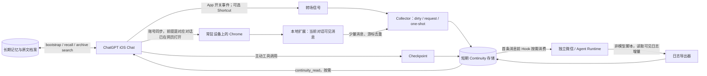

# Cross-Entry Continuity｜跨入口聊天连续性

**中文主分支 `main`** · [English branch / Full English version](https://github.com/Elisekaiu/Cross-entry-continuity/tree/english)

**在 ChatGPT Chat、个人 Agent／微信端之间传递少量、可信、按需的上下文。** 这不是 ChatGPT 官方的会话同步 API，也不承诺 iOS 原生 App 自动跨窗抓取。

> **项目定位：架构分享 + 可运行的最小参考实现。** 文档基于一套真实使用的双向系统；`examples/` 为重新整理的通用示例，而非私人生产代码原样公开。不同系统需自行接入对应的存储、MCP／插件、消息入口及认证。

[扩展代码分享取舍](docs/EXTENSION.md) · [完整链路](docs/ARCHITECTURE.md) · [部署与环境](docs/SETUP.md) · [安全和隐私](SECURITY.md) · [致谢](CREDITS.md) · [实际验证与限制](docs/LIMITATIONS.md)

## 不只适用于 ChatGPT：也写给希望长期相处的 AI 伴侣使用者

**这是一套可迁移的设计，不是 ChatGPT 专属插件。** 如果你有两个或更多 AI 聊天入口，希望它们各自保有独立会话、同时在必要时接上另一边刚发生的事，可以沿用这里的三条原则：**来源可验证、上下文分层、按需消费**。例如长期陪伴型 Agent、跨手机/桌面的个人助手，或分别负责生活聊天与项目工作的两个模型。我们自己的动机包括长期人机陪伴中的转场体验，但系统没有绑定某个角色、关系形式或私有记忆产品。

其他聊天产品即使没有 webhook，**也不代表都可以直接套用本扩展**：需要分别确认有无合法可访问的聊天记录出口、页面结构、登录态、导出权限、Hook 或其他接入点，并遵守对应平台条款；若完全无法访问会话记录，可以退化为“用户主动写 checkpoint + 另一端按需读取”的轻量方案。**实际测试只覆盖下文列出的 ChatGPT Chat + 独立 Agent 组合**。见 [其他平台适配指南](docs/ADAPTERS.md)。

## 为什么这么绕？

我们的主聊天空间是 **ChatGPT 的普通 Chat**，另一边是独立的 Codex/Agent 聊天运行时。我们希望两边能各自继续工作，不用每次手动复述，又不想频繁启动另一个模型去总结、重复烧额度或塞满上下文。

截至 2026 年 11 月，**普通 Chat 对话没有面向用户、支持“每有一条聊天消息就 webhook 通知你的服务器”的通用官方接口**。ChatGPT Work 的 Scheduled / event-triggered tasks 能响应**支持的外部应用事件**，例如 Gmail、Slack 和 GitHub；它不能等价替代从普通 Chat 每条消息原样推送的 webhook。我们喜欢 Chat 和另一个 Agent **双线程并行**，所以没有为了这件事强迫所有聊天搬到 Work，也不想依赖高频定时唤醒。详见 [设计取舍](docs/WHY.md)。

## 设计：别把「记忆」当成一锅粥

| 层 | 处理什么 | 生命周期与代价 |
| --- | --- | --- |
| **Core / Bootstrap** | 关系与项目核心设定、稳定偏好、重要约定 | 轻量；新会话／明显返场时按需读取 |
| **Long-term memory** | 长期经验、事实、决定与意义 | 单独索引、可查、可更新；不是原文聊天 |
| **Archive / evidence** | 可追溯的逐字历史 | 按天或按 ID 检索；不每轮注入全文 |
| **Continuity** | 最近另一个入口真实发生的几句话 | 短期 TTL、消息去重、有限窗口 |
| **Checkpoint** | 一句话记录「现在共同处理到哪儿」 | 适合跨入口转场；抓取失败时兜底 |

**Checkpoint ≠ Archive ≠ Memory。** 单个组件故障时，不应让其他层跟着失效。

## 实际链路（概览）



这里的箭头并不表示 iOS 原生聊天内容直接进入 Chrome。**跨窗和网页未打开目标对话仍是明确限制**。`Shortcut` 只传「打开／关闭」信号，不携带 conversation ID 或聊天原文。

## 我们实际使用的设备／环境

- **手机**：iOS ChatGPT 原生 App；Shortcuts 负责可选的 App 开关事件，不是聊天抓取器。
- **常驻浏览器设备**：MacBook + Chrome（Manifest V3 扩展）；**真正必需的是可长期开启、能登录 ChatGPT 网页版的 Chromium 环境**。其他桌面设备理论上可能替换，**未在本项目完成实测**。
- **服务器**：Linux VPS，容器化 Node.js HTTP 服务、短期事件库、独立 Agent Runtime 和 hook。
- **消息入口**：实际为微信侧的独立 Codex/Agent；可换成其他支持 Hook、日志导出或 MCP 的运行时，但需自己适配。
- **记忆工具**：一个具备 bootstrap／long-term recall／raw archive／short-term continuity／checkpoint 能力的自有工具层。**不是官方 ChatGPT 默认提供的一整套能力**。

### 最小前提（不满足就先别折腾）

1. 有两个可独立工作的聊天入口，且其中一个允许你运行 Hook 或读取其本地聊天日志。
2. 有可长期运行的 Chromium 浏览器设备，已经登录 ChatGPT 网页版，并且**正确的 Chat 对话页面确实在其中打开**。
3. 有你控制的 HTTPS／私网桥接端点，能安全接收短期消息；绝对不要把 ChatGPT cookies、session tokens 传给 VPS。
4. 有真实的原文增量游标与 ACK 机制，失败应 **abandon / skip** 而不是让模型无限重试。
5. 如果希望新 Chat 对话自动衔接，还需要能从该 Chat 主动调用的插件／MCP 工具及恰当的说明。**提示词只能提升触发概率，无法保证每次调用。**

## 功能与成本取舍

- 按需触发：App 关闭标记 dirty，**不是**每次后台检查都要求模型参与；微信下一条真实消息的 Hook 才进入同步流程。
- 尽量只取当前分支的 `user` / `assistant` 可见文本，不上传 tool payload、附件、隐藏消息、完整 mapping 或访问凭证。
- 每次选择最近 **4 条、约 600 Unicode 字符**（本案例当前生产值；开源示例可配置），按对话与消息 ID 去重。
- 有任务游标、消费 ACK、时间窗口和窗口身份检查，尽量不重复注入；失败一次性终止。`no_delta` 不是 `failed`。
- 另有由 Chat 侧主动留下的短小 checkpoint。扩展坏掉时它仍能提供「正在做什么」的最低限度背景。
- 反向由**普通本地脚本**增量读取独立 Agent 的可见日志，写入短期存储；不需要模型每次总结。

## 参考代码（可运行的最小演示）

```
examples/
  collector/        # 本地短期事件存储及 one-shot 请求/ACK 状态机
  extension/        # Chrome MV3：DOM-only 参考抓取，含 dry-run；不自带私人 API
  hook/             # 独立 Agent 的 UserPromptSubmit 参考 Hook
  wechat-export/    # 从 JSONL 输出增量可见消息的示例导出器
  instructions/     # 可脱敏复用的 Chat / Agent 指令模板
```

```bash
# 需 Node.js 22+；演示仅限本机 loopback
npm test
cp .env.example .env
# 为 .env 填入随机强令牌
npm run demo:server
```

接着在 `examples/extension` 按 [SETUP](docs/SETUP.md) 安装；插件默认 **DRY RUN**，不会发送聊天内容。演示版 collector 不是生产级服务；缺少身份治理、私有网络代理、备份和多实例协调。**不要直接开放到公网。**

## 已知边界／不要误读

- iOS 原生 ChatGPT App 不会把当前 conversation ID 或聊天正文自动交给 Chrome 扩展；打开另一条 iOS 对话 **不会使 Mac 标签自动切换**。
- Chrome 当前网页 **不是**「iPhone 当前窗口」的可靠真相。抓错比不抓更糟；无法确认时 fail closed。
- Chrome 必须常驻或能恢复，适配网页 UI 的采集代码随官方 DOM/API 改动而可能失效。
- 新 Chat / 长时间返场时提示模型调用 bootstrap 与 continuity，是 **best effort**。模型不一定主动调用；人工轻提醒有时仍必要。
- 让模型“每条回复写当前时间戳”不等于拥有可靠时钟。更稳妥的是**宿主在每条消息中注入可信时间戳**，然后由工具/Hook 按时间差做触发。
- 这里展示的是一套私有场景的设计经验，不是官方 OpenAI 产品、没有 100% 成功率的跨端同步承诺。

详细：[限制清单](docs/LIMITATIONS.md) · [风险模型](SECURITY.md) · [常见问题](docs/FAQ.md)

## 语言与贡献

- 中文：[`main`](https://github.com/Elisekaiu/Cross-entry-continuity/tree/main)（当前分支）
- English：[`english`](https://github.com/Elisekaiu/Cross-entry-continuity/tree/english)（整份文档英文化、示例源码同功能）
- 改进前请阅读 [贡献与发布检查](PUBLISHING.md)，不保证各平台均能兼容。

## 致谢与许可

我们的原文导出思路最早研究过 [OwlCt/ChatGPT-Export](https://github.com/OwlCt/ChatGPT-Export)（MIT）；它的上游作者与许可详情见 [CREDITS.md](CREDITS.md)。后续浏览器采集还参考／比较了数个公开实现；**“研究过”不等于“直接复制了源代码”**。这个仓库里的通用示例由本项目重新整理，其代码以 [MIT License](LICENSE) 发布。

> 分享的是方法、失败处理与取舍。个人域名、真实令牌、私人记忆、对话正文、完整服务配置和生产扩展不会发布。
