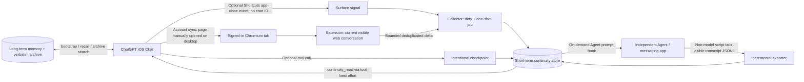

# Cross-Entry Continuity

**English branch `english`** · [中文版 main / Full Chinese edition](https://github.com/Elisekaiu/Cross-entry-continuity/tree/main)

> **A small bridge for conversations that happen in different places.** Keep each chat thread independent, while sharing a little recent context whenever it helps the conversation flow.
>
> **One important boundary: this is not transcript synchronization or chat-history mirroring.** Each surface keeps its own native history. The bridge carries only small pieces of recent context, checkpoints and retrievable memory; the other side reads them on demand through a hook or tool. Agent / messaging-app replies do not automatically appear as message bubbles inside the original ChatGPT thread, and vice versa.

[Architecture](docs/ARCHITECTURE.md) · [Protocol & state machine](docs/PROTOCOL.md) · [Instructions we use](docs/INSTRUCTIONS.md) · [Setup](docs/SETUP.md) · [Other AI platforms](docs/ADAPTERS.md) · [Safety](SECURITY.md) · [Credits](CREDITS.md)

## Beyond ChatGPT: useful for AI companionship and multi-agent workflows

The same idea can be adapted to different AI chat services and personal agents. People who spend time with companion AIs across different apps—or use one thread for everyday conversations and another for active projects—may want enough short-term context to resume naturally without collapsing everything into one giant prompt. The same design also suits personal assistants, multi-device conversations, and separate work/life agents.

If another AI platform has no message webhook, check whether it provides a *permitted* export, readable local transcript, or supported browser access. If direct access is unavailable, a short checkpoint and a retrieval tool are already a useful place to start. Our hands-on testing so far covers the ChatGPT Chat + independent Agent setup described below.

## Why so many pieces?

Our primary chat lives in **ordinary ChatGPT Chat**, while a separate Agent/Codex runtime has its own conversation. We want both to run independently, with minimal duplicate storytelling and minimal model usage for routine sync. As of November 2026, ordinary Chat does not provide a general user-facing outgoing webhook for *every Chat message*. ChatGPT Work offers supported external event-triggered/scheduled workflows, but that is **not** the same thing as a per-message Chat webhook. We prefer keeping these independent threads, rather than using repeated Work tasks to transfer a whole transcript.

## Five separate information layers

| Layer | Purpose | Why separate? |
| --- | --- | --- |
| **Core / Bootstrap** | Lightweight identity, stable project/relationship context and important agreements | Read on a new chat or meaningful return, not every turn |
| **Long-term memory** | Indexed facts, choices and meaningful history | Selective recall, not raw log replay |
| **Verbatim archive** | Evidence: original quotes, dates, exact wording | Search only when exact details matter |
| **Short-term continuity** | Recent messages from another entrance, usually with TTL | Small bounded deltas; not permanent memory |
| **Checkpoint** | One deliberate sentence about current progress and next steps | Survives a failure of the browser capture path |

`checkpoint != archive != long-term memory`. Components may share an MCP/plugin gateway, but each has distinct lifecycle and trust assumptions.

## Actual architecture



Shortcuts carries app open/close signals. The extension reads the conversation **actually open on desktop Chrome**, so switching chats on the iPhone currently also requires opening the corresponding desktop page.

## Our confirmed environment

- iOS ChatGPT app and optional iOS Shortcuts for app open/close events.
- MacBook with a signed-in Chrome MV3 extension; the real desktop requirement is an **always-on supported Chromium environment**, not a Mac-specific feature. Other OS/browser combinations are plausible but **not verified**.
- Linux VPS running a Node.js collector, short-term event store and independent Codex/Agent runtime.
- Agent-side prompt hook with bounded wait, plus a local visible-log reader with byte offsets and idempotent messages.
- A connected memory tool that provides bootstrap, long-term recall, verbatim archive, short-term continuity and checkpoint writing.

## What you need to try it

1. Two independently functioning chat entrances; at least one lets you attach hooks or access your own transcript in a permitted way.
2. A long-running desktop Chromium instance authenticated to the chat website, with the **correct conversation open** if using browser capture.
3. A secure HTTPS/private network bridge under your control and a short-lived store. Keep ChatGPT session credentials on the browser device.
4. Stable conversation/message IDs where available, a deduplication cursor, and a consume ACK. A failed transition should terminate, not burn model quotas in an endless loop.
5. For Chat-side retrieval, a connected tool plus instructions that describe when to bootstrap, read recent context, and leave a checkpoint.

## Features and token budget

- App-close marks a possible transition; the next **real Agent user prompt** triggers its preflight. No LLM needed for routine status checks.
- Visible `user`/`assistant` messages only; omit tool internals, hidden nodes and attachments.
- Current private production budget: at most **4 messages / ~600 Unicode characters** per handoff; open sample is configurable and demonstrates ID-based deduplication.
- One-shot transitions, bounded waits, job-specific ACK, fail-closed conversation checks and a clear `no_delta` vs `failed` distinction.
- A separate short checkpoint can preserve critical current progress if the extension fails.
- The reverse handoff tails the other Agent's visible JSONL transcript in ordinary code—no repeated summary-model calls.
- For a deeper explanation of revisions, ACK timing, pending cursors, terminal failures and reverse byte cursors, see [Protocol & state machine](docs/PROTOCOL.md). For the generalized prompt rules we actually use, see [Instructions](docs/INSTRUCTIONS.md).

## Runnable minimal reference

```text
examples/
  collector/        # loopback-only HTTP collector and transition state machine
  extension/        # Chrome MV3 DOM-only demo, defaults to dry-run
  hook/             # example UserPromptSubmit hook
  wechat-export/    # incremental visible JSONL exporter
  instructions/     # best-effort tool and hook instruction templates
```

```bash
npm test
cp .env.example .env # insert a strong random token
npm run demo:server
```

Requires Node.js 22+. The sample collector listens on loopback and defaults to preview mode. Follow [Setup](docs/SETUP.md) to connect your own environment; for remote access, add private HTTPS/VPN transport and appropriate authentication.

## What we're still exploring

- iOS ChatGPT conversation switching does **not** automatically switch the desktop tab; Shortcuts cannot supply a reliable Chat conversation ID or transcript.
- You need a running browser (or manual reactivation). DOM and unofficial website APIs can change.
- **Automatic return-time retrieval:** Our instructions invite a new or returning Chat session to read bootstrap and continuity. Whether the model calls the tools on its own varies; a gentle reminder often works well.
- **Time-gap detection:** User instructions can ask the model to reread context after a long absence, but Chat does not necessarily provide a reliable timestamp for every message on the model side. If your setup already checks a reliable current time each turn, or supplies actual message timestamps, return-after-a-gap triggers may work more consistently. Printing a time label alone is different from having reliable time information.
- Windows/Linux Chromium, other AI platforms and other messaging agents are **possible adaptations, not tested combinations**.

## Attribution and licensing

Our early export/archive exploration referenced [OwlCt/ChatGPT-Export](https://github.com/OwlCt/ChatGPT-Export) and its upstream acknowledgements. We also studied several browser-extension implementations. See [Credits](CREDITS.md) and the included [MIT License](LICENSE). The general-purpose examples keep personal configuration, private messages and long-term memory data in their owners' environments.

**Chinese:** [main branch](https://github.com/Elisekaiu/Cross-entry-continuity/tree/main) · **English:** [english branch](https://github.com/Elisekaiu/Cross-entry-continuity/tree/english)
