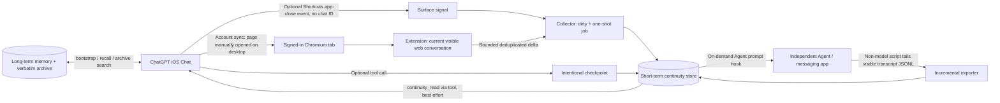

# Cross-Entry Continuity

**English branch `english`** · [中文版 main / Full Chinese edition](https://github.com/Elisekaiu/Cross-entry-continuity/tree/main)

> **An architecture write-up and runnable minimal reference** for small, trustworthy, on-demand context handoff between separate AI chat entrances. Not an official ChatGPT Chat webhook, not turnkey iOS conversation mirroring, and not a copy of our private deployment.

[Architecture](docs/ARCHITECTURE.md) · [Setup](docs/SETUP.md) · [Other AI platforms](docs/ADAPTERS.md) · [Limitations](docs/LIMITATIONS.md) · [Safety](SECURITY.md) · [Credits](CREDITS.md)

## Beyond ChatGPT: useful for AI companionship and multi-agent workflows

The architecture is **platform-agnostic in principle**, not an extension that automatically works on every chatbot. People who spend time with companion AIs across different apps—or use one thread for everyday conversations and another for active projects—may want enough short-term context to resume naturally without collapsing everything into one giant prompt. The same design also suits personal assistants, multi-device conversations, and separate work/life agents.

If another AI platform has no message webhook, check whether it provides a *permitted* export, readable local transcript, or supported browser access. If none exists, use a manual checkpoint and a retrieval tool instead of pretending that a scraper is reliable. **Only the ChatGPT Chat + independent Agent environment below has actually been tested.**

## Why so many pieces?

Our primary chat lives in **ordinary ChatGPT Chat**, while a separate Agent/Codex runtime has its own conversation. We want both to run independently, with minimal duplicate storytelling and minimal model usage for routine sync. As of November 2026, ordinary Chat does not provide a general user-facing outgoing webhook for *every Chat message*. ChatGPT Work offers supported external event-triggered/scheduled workflows, but that is **not** the same thing as a per-message Chat webhook. We prefer keeping these independent threads, rather than using repeated Work tasks to transfer a whole transcript.

## Five separate information layers

| Layer | Purpose | Why separate? |
| --- | --- | --- |
| **Core / Bootstrap** | Lightweight identity, stable project/relationship context and important agreements | Read on a new chat or meaningful return, not every turn |
| **Long-term memory** | Indexed facts, choices and meaningful history | Selective recall, not raw log replay |
| **Verbatim archive** | Evidence: original quotes, dates, exact wording | Search only when exact details matter |
| **Short-term continuity** | Recent messages from another entrance, usually with TTL | Small bounded deltas; not permanent memory |
| **Checkpoint** | One deliberate sentence about current progress and next steps | Survives a failure of the browser capture path |

`checkpoint != archive != long-term memory`. Components may share an MCP/plugin gateway, but each has distinct lifecycle and trust assumptions.

## Actual architecture



**The arrows do not mean Chrome can see the active conversation in the iOS app.** The desktop browser must actually show the intended conversation. Shortcuts only sends surface events, not message text or conversation IDs.

## Our confirmed environment

- iOS ChatGPT app and optional iOS Shortcuts for app open/close events.
- MacBook with a signed-in Chrome MV3 extension; the real desktop requirement is an **always-on supported Chromium environment**, not a Mac-specific feature. Other OS/browser combinations are plausible but **not verified**.
- Linux VPS running a Node.js collector, short-term event store and independent Codex/Agent runtime.
- Agent-side prompt hook with bounded wait, plus a local visible-log reader with byte offsets and idempotent messages.
- A private memory tool exposing bootstrap, recall, verbatim archive, continuity-read and checkpoint-write capabilities. **These are not all built into ChatGPT by default.**

## Minimum requirements

1. Two independently functioning chat entrances; at least one lets you attach hooks or access your own transcript in a permitted way.
2. A long-running desktop Chromium instance authenticated to the chat website, with the **correct conversation open** if using browser capture.
3. A secure HTTPS/private network bridge under your control and a short-lived store; **never forward ChatGPT session tokens/cookies**.
4. Stable conversation/message IDs where available, a deduplication cursor, and a consume ACK. A failed transition should terminate, not burn model quotas in an endless loop.
5. For automatic Chat-side retrieval, connected tools and clear best-effort instructions. Prompt wording cannot force tool calls reliably.

## Features and token budget

- App-close marks a possible transition; the next **real Agent user prompt** triggers its preflight. No LLM needed for routine status checks.
- Visible `user`/`assistant` messages only; omit tool internals, hidden nodes and attachments.
- Current private production budget: at most **4 messages / ~600 Unicode characters** per handoff; open sample is configurable and demonstrates ID-based deduplication.
- One-shot transitions, bounded waits, job-specific ACK, fail-closed conversation checks and a clear `no_delta` vs `failed` distinction.
- A separate short checkpoint can preserve critical current progress if the extension fails.
- Reverse sync tails the other Agent's visible JSONL transcript in ordinary code—no repeated summary-model calls.

## Runnable minimal reference

```text
examples/
  collector/        # loopback-only HTTP collector and transition state machine
  extension/        # Chrome MV3 DOM-only demo, defaults to dry-run
  hook/             # example UserPromptSubmit hook
  wechat-export/    # incremental visible JSONL exporter
  instructions/     # best-effort tool and hook instruction templates
```

```bash
npm test
cp .env.example .env # insert a strong random token
npm run demo:server
```

Requires Node.js 22+. The demo is **loopback only and not production hardened**. See [Setup](docs/SETUP.md) before changing any hosts or enabling upload. The private production extension uses additional sources that are deliberately not redistributed.

## Limitations worth stating upfront

- iOS ChatGPT conversation switching does **not** automatically switch the desktop tab; Shortcuts cannot supply a reliable Chat conversation ID or transcript.
- You need a running browser (or manual reactivation). DOM and unofficial website APIs can change.
- Bootstrap and continuity retrieval inside ordinary Chat are **best effort**, not a deterministic host hook. A brief manual reminder can be required.
- A model does not acquire a trustworthy clock merely because a prompt tells it to print timestamps. Prefer host-supplied timestamps, and let the hook decide when enough time elapsed.
- Windows/Linux Chromium, other AI platforms and other messaging agents are **possible adaptations, not tested combinations**.

## Attribution and licensing

Our early export/archive exploration referenced [OwlCt/ChatGPT-Export](https://github.com/OwlCt/ChatGPT-Export) and its upstream acknowledgements. Later browser-extension implementations were **studied**, not copied as a whole. See [Credits](CREDITS.md) and the included [MIT License](LICENSE). The generalized sample was rewritten without personal configuration, message content, secrets or original private memory implementations.

**Chinese:** [main branch](https://github.com/Elisekaiu/Cross-entry-continuity/tree/main) · **English:** [english branch](https://github.com/Elisekaiu/Cross-entry-continuity/tree/english)
