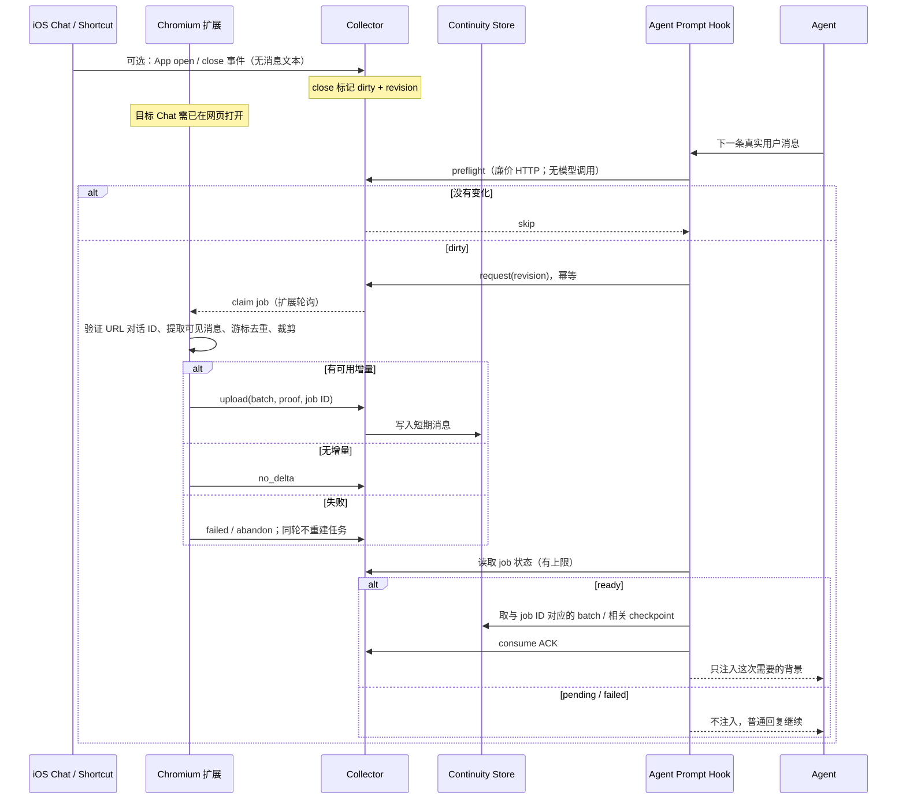
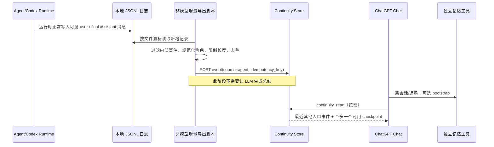

# 架构与时序

本页记录**生产设计事实**；`examples/` 是通用参考，不是与私人部署完全同构的代码。

## A. 官端 Chat → 另一个 Agent 入口

**为什么不是一直轮询直到成功？** 避免一次网页抓取失败让 Agent 每条消息都等待、反复触发或烧掉上下文。生产设计里还存在「已上传但未消费」状态；它可以被之后的 Hook 消费，但**不能因此无限重发上传**。

### 生产参考的预算

- Chat 网页当前对话、当前分支优先。
- `user` / `assistant` 可见内容；最多 4 条、约 600 Unicode 字符；超长消息可按头尾裁剪。
- 通过消息 ID + 辅助指纹做去重；避免把同一句话第二次发送误判为旧消息。
- 本地缓存、时间窗口、capture job ID / transition revision、ACK 后提交消费游标。
- 失败后终态跳过这一轮，下一次真实会话活动产生新 revision。

## B. 另一个 Agent → 官端 Chat

实际系统的 Agent 是长期运行的 Codex，会把可见消息落在本地 rollout JSONL。读档脚本根据文件偏移维护 `continuity_cursors`，通过服务器 API 发送短期事件（含角色、时间、来源和幂等键）。它与长周期逐字归档共享部分读取路径，但目的不同：**归档可以多年保留，continuity 只承担短期接续**。

实际读取工具还有一个防回音规则：普通官端读取默认优先取来自另一个入口的消息及本入口 checkpoint，**不把官端的原文 shadow batch 再喂回官端**。否则会无意义自我重复。

## C. 长期记忆不等于跨端增量

- `bootstrap`：小而固定的关系/项目核心、风格骨架，避免每次全量搜索。
- `recall`：长期语义记忆，涉及既往决定、重要事件时按主题检索。
- `archive`：逐字证据的精确搜索（按日期、短语、上下文），避免把模糊记忆当原话。
- `continuity_read`：最近 24h 跨入口碎片与 checkpoint；实际 TTL 可调整。
- `continuity_write`：由官端主动写下非常短的转场背景；不等于日常聊天日志。

这些可以用一个 MCP/插件统一对外暴露，也可以用多个服务；**概念边界比产品名字更重要**。

## D. iOS Shortcuts 的准确位置

Shortcut 的作用是 `app opened / closed` **surface event**；它不读取 ChatGPT 聊天内容，也不拿 conversation ID。扩展在电脑 Chrome 中抓的是**当前网页标签**，不是 iOS 当前窗口。若网页没有打开对应对话，必须停下或返回无可靠快照。**不要把最近更新的账号对话猜成手机那条。**

## E. 审查与责任边界

在 ChatGPT 网页中读取私有接口会受 UI、认证和条款约束，接口可随时变化；公开示例改为 DOM-only 参考实现。上游导出项目主要用于用户自有会话归档，并不意味着官方认可自动 webhook。仅处理本人有权访问的聊天，隐私文件不要上传到第三方托管平台。
