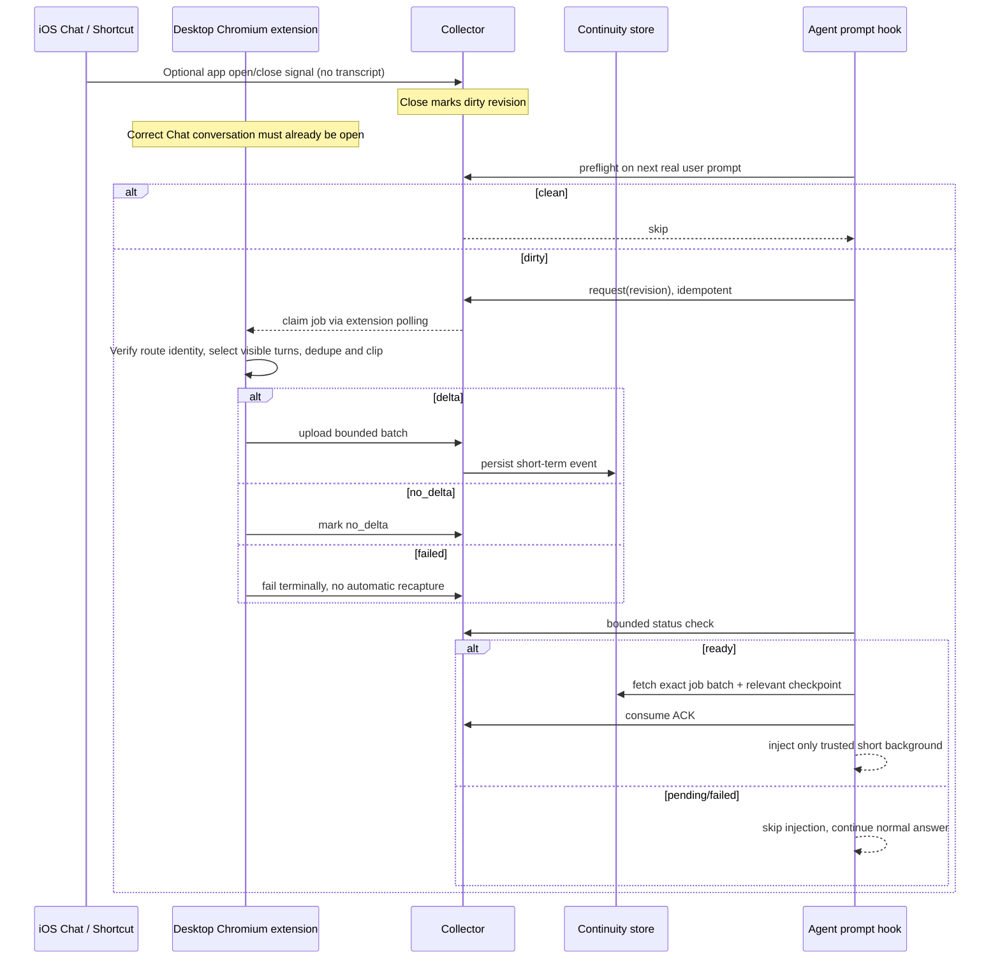
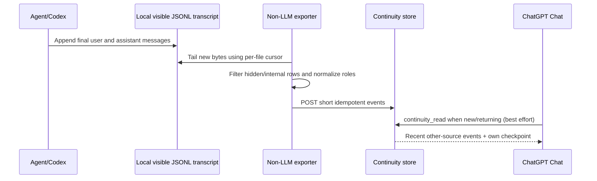

# Architecture and handoff sequence

This page follows the two directions of our working handoff flow. Runnable simplified examples live in `examples/`.

## A. Chat → independent Agent

An uploaded batch can wait for a later prompt to consume it. A failed handoff ends that transition; fresh Chat activity creates a new one. This keeps the other conversation moving without repeated retries.

### Example production limits

- Prefer visible current branch `user` and `assistant` text; at most **4 turns / 600 Unicode characters** in the current private setup.
- Conversation ID and stable message IDs, with fingerprint fallback for changing DOM identities.
- A job ID, revision, ACK and consumed cursor. Keep the cursor until the downstream consumer has confirmed it.
- A failed terminal job must not create another job for the same revision.

## B. Independent Agent → Chat

The actual Codex runtime writes rollout JSONL; an independent script holds per-file byte offsets, sends visible text and timestamps with idempotency keys, and never asks a model to summarize each turn. A separate archive can preserve exact original text much longer than the short-term continuity TTL.

A source-filtered read avoids feeding a Chat-produced shadow batch back into the same Chat. Without it, context can bounce between entrances repeatedly.

## C. Memory is not continuity

- **Bootstrap:** small stable relationship/project core for new sessions.
- **Recall:** indexed long-term semantic memory only when earlier decisions or facts matter.
- **Verbatim archive:** exact historical words, by phrase/date/ID.
- **Continuity:** recent cross-surface fragments, e.g., 24-hour TTL.
- **Checkpoint:** one intentional current-work note written by Chat; only when needed.

Any MCP/plugin tool layer can expose these concepts. They need not be the same product or database, but their lifecycles and responsibilities should remain separate.

## D. The role of iOS Shortcuts

An app-open/close Shortcut reports a surface event. It does **not** read the native ChatGPT transcript or active conversation ID. Desktop Chrome captures the conversation **actually open in its own tab**, not necessarily the one open on the phone. When a matching desktop conversation cannot be confirmed, the capture ends this turn without forwarding messages.

## E. Maintaining browser capture

Web page nodes and private interfaces may change with platform updates. The sample uses a DOM-only capture path for easier reading and adaptation. When customizing it, check site permissions, browser identity, message visibility and upload destinations.

## F. Deeper protocol notes

The state machine, ACK-before-cursor-commit rule, `no_delta` vs `failed`, repeated-text edge case and reverse byte cursor are documented in [PROTOCOL.md](PROTOCOL.md).
