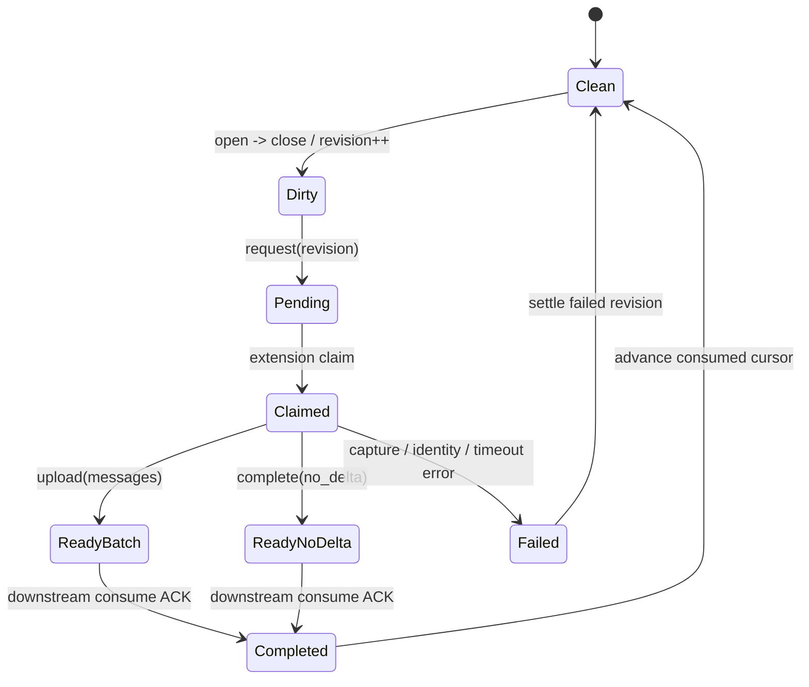

# Protocol and state machine notes

This page goes one layer deeper than the architecture diagram and explains the state model used by the runnable reference.

## 1. Four data objects

### Surface transition

A lightweight signal such as:

```json
{"app":"chatgpt","event":"open","at":"2026-11-11T10:00:00Z"}
{"app":"chatgpt","event":"close","at":"2026-11-11T10:12:00Z"}
```

The signal contains no transcript. An `open -> close` pair advances the `revision` and marks the source as dirty.

### Capture job

A one-shot browser capture request tied to one revision:

```json
{
  "id": "job_...",
  "revision": 42,
  "status": "pending",
  "capture_start": "...",
  "capture_end": "..."
}
```

Because every request is attached to a revision, repeated `request(revision)` calls remain idempotent.

### Continuity event

The short-lived context actually stored for later reading:

- `source=official, kind=message`: Chat -> Agent message batch
- `source=official, kind=checkpoint`: deliberate Chat-side checkpoint
- `source=agent, kind=message`: Agent -> Chat visible-log event

### Cursors

Two useful cursor families:

1. **message cursor**: which message IDs have truly been consumed downstream
2. **file byte cursor**: how far the reverse JSONL exporter has read

Both exist to move only new information.

---

## 2. Chat -> Agent state flow



The prompt hook only needs four high-level `preflight` actions:

| action | meaning | hook behavior |
| --- | --- | --- |
| `skip` | no new transition | continue the normal reply |
| `capture` | a new dirty revision exists | create one capture job |
| `in_flight` | pending/claimed work already exists | do not create another job |
| `consume_ready` | a ready job exists | read its event, ACK, inject compact context |

This keeps browser-specific logic out of the Agent hook.

---

## 3. Commit seen IDs only after downstream ACK

This is one of the most useful invariants in the design.

Suppose the extension captures `m101, m102, m103`:

1. upload succeeds
2. the collector stores the continuity event
3. the Agent hook crashes before reading it

If the extension marked those IDs as fully seen at step 1, they would disappear from future selection even though the Agent never received them.

A safer sequence is:

```text
upload -> pending seen IDs
downstream read -> consume ACK
extension observes completion -> commit pending IDs to seen cursor
```

The public extension's local `pending` record demonstrates this pattern.

### Repeated text with a new stable ID

Text fingerprints are useful when DOM IDs drift, but a reliable new message ID should take priority.

```text
m100 user: "same text"
m102 user: "same text"
```

The second row is a real new turn. In our production implementation, stable IDs are authoritative and fingerprints are only a fallback. The public reference stays intentionally smaller and demonstrates the ID cursor directly.

---

## 4. `no_delta` and `failed` are different states

They may both produce "no context injected this turn", but they mean different things.

### no_delta

The browser identity and capture succeeded; there simply were no unseen messages.

That is a successful empty handoff.

### failed

The capture itself did not complete, for example:

- no unambiguous Chat tab
- route mismatch
- page parser changed
- bounded wait expired
- upload failed

Keeping the states separate makes diagnostics and retry behavior much easier to reason about.

---

## 5. Why a failed revision does not rebuild itself forever

Every new Agent prompt runs the hook. If a failed revision remains eligible for `capture`, each prompt can recreate the same job.

We instead treat failure as terminal for that transition:

```text
revision 42 -> failed
terminal/consumed cursor advances
revision 42 is not recreated
next real open -> close => revision 43
```

There is one ordering caveat: if an older revision already has a `ready` batch waiting for ACK, a newer failed revision must not skip past it. The older ready batch is consumed first; only then can the later failed revision settle.

---

## 6. Time windows vs message cursors

`capture_start` and `capture_end` are useful for describing roughly when a surface was active, but browser DOM messages do not always carry reliable timestamps.

A practical split we ended up using:

- **current route is strongly verified** -> prefer the unseen message cursor
- **cached / weaker fallback snapshot** -> use capture window and cache freshness as additional constraints

A fresh DOM tail should not become `no_delta` merely because it lacks a message timestamp.

---

## 7. Why the Agent hook runs before the next real user message

The Agent itself does not need to continuously poll for continuity.

```text
user sends a message
-> UserPromptSubmit hook
-> cheap HTTP preflight
-> only if needed: capture / consume
-> inject short background
-> model answers normally
```

This keeps idle token use near zero and lets normal replies continue when the context handoff is unavailable.

The public hook waits up to 8 seconds for demonstration purposes. The important design point is the bounded wait, not the exact number.

---

## 8. Reverse direction: Agent -> Chat

If the Agent runtime already writes a visible transcript, ordinary code can tail it directly.

The exporter maintains a byte cursor:

```json
{
  "path": "/path/to/transcript.jsonl",
  "offset": 123456
}
```

It reads only bytes after the cursor and processes complete JSONL records.

After filtering, it keeps:

- visible user messages
- final assistant answers

and skips:

- system/developer instructions
- tool payloads
- internal wake events
- reasoning/hidden events

On first run, the reference records the current EOF instead of backfilling old history. Later records use either the real message ID or:

```text
sha256(role + "\0" + text)
```

as an idempotency key.

---

## 9. Reference HTTP endpoints

| Method | Path | Purpose |
| --- | --- | --- |
| GET | `/health` | health check |
| POST | `/surface` | report open/close |
| GET | `/sync/preflight` | hook asks what to do |
| POST | `/sync/request` | create a capture job for a revision |
| GET | `/jobs/claim` | browser claims pending work |
| GET | `/sync/status?job_id=...` | hook checks job state |
| POST | `/jobs/:id/upload` | browser uploads bounded message batch |
| POST | `/jobs/:id/complete` | explicitly report no_delta |
| POST | `/sync/consume` | downstream ACK |
| POST | `/sync/abandon` | terminally end a failed job |
| POST | `/continuity/handoff` | write checkpoints / reverse events |
| GET | `/continuity/latest` | query by source, kind or job |

Every reference endpoint except `/health` requires the configured Bearer token.

---

## 10. Constraints that survived real failures

These all correspond to concrete failure modes we encountered:

- conversation-ID verification
- stable message-ID cursor
- fingerprint fallback for unstable DOM identity
- pending seen IDs + downstream consume ACK
- bounded payload size
- bounded hook wait
- terminal failure per transition
- `no_delta != failed`
- checkpoint fallback
- source filtering to prevent self-echo
- short TTL for recent continuity

The smallest useful setup is still much simpler: **checkpoint + continuity_read**. Job state, ACKs, browser capture and reverse-log cursors can be added incrementally.
